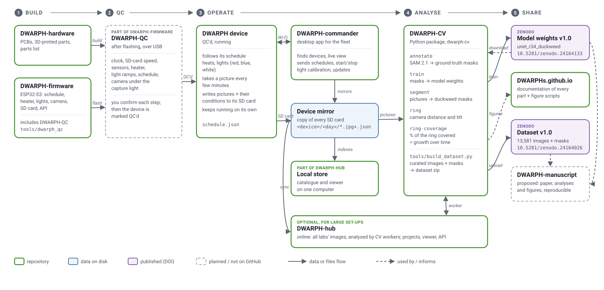

# Modules {#modules}

DWARPH is made of a few parts, each in its own repository of the [DWARPHs GitHub organisation](`r GITHUB_ORG_URL`), used in this order: build a device, check it, operate it, analyse the pictures, share the results.

<div class="figure" style="text-align: center">
<span style="display:block;" id="fig:architecture"></span>
<object data="assets/project-map.svg" type="image/svg+xml" style="width: 100%; max-width: 1400px;" aria-label="Project map">

</object>
<p class="caption">(\#fig:architecture) How the parts of DWARPH fit together, in the order you use them: build a device, check it with QC (part of the firmware), operate it, analyse the pictures, share the results. Click a part to open its repository or its Zenodo record.</p>
</div>

```{r, echo=FALSE}
df <- tibble::tribble(
  ~Part, ~Chapter, ~"What it is",
  "[DWARPH-hardware](https://github.com/DWARPHs/DWARPH-hardware)", "\\@ref(device)", "Circuit boards, 3D-printed parts and the list of off-the-shelf parts; the [device build guide](build/)",
  "[DWARPH-firmware](https://github.com/DWARPHs/DWARPH-firmware)", "\\@ref(device)", "The program on the device's ESP32-S3: schedule, temperature and lights, camera, SD card, Wi-Fi; includes the QC check of a new device",
  "[DWARPH-commander](https://github.com/DWARPHs/DWARPH-commander)", "\\@ref(commander)", "Desktop app that finds the devices on the network, drives them and copies their SD cards",
  "[DWARPH-CV](https://github.com/DWARPHs/DWARPH-CV)", "\\@ref(cv)", "Image analysis: duckweed segmentation and ring coverage, camera distance and tilt; training and annotation; the hub's workers",
  "[DWARPH-hub](https://github.com/DWARPHs/DWARPH-hub)", "\\@ref(hub)", "*Optional, for large set-ups:* a server that backs up, analyses and shows every device's pictures, organised in projects",
  "[DWARPHs.github.io](https://github.com/DWARPHs/DWARPHs.github.io)", "", "This documentation"
)
knitr::kable(df)
```

Each chapter covers one part: the **device** (hardware, firmware and QC), the **Commander**, **DWARPH-CV** and the optional **hub**, then **utilities** such as the schedule builder, the **publications** and how to get help. The appendices describe running an experiment and the technical reference.
