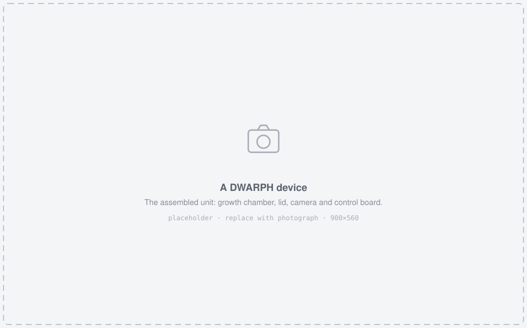

# Device {#device}

A DWARPH device is a small growth chamber that looks after itself. It is made of three things:

* the **hardware**: circuit boards, 3D-printed parts, a camera looking down at the water surface,
  a red reference ring around the growing area, a heater, and red, blue and white lights;
* the **firmware**, the program on the device's ESP32-S3 microcontroller: it follows the
  experiment's schedule (temperature and light over time), takes a picture at regular intervals,
  writes the pictures and the conditions to its SD card, and answers the Commander over Wi-Fi;
* **QC**, a check built into the firmware: a newly built device runs nothing until a person has
  gone through every part of it, step by step, at the bench.

```{r device-photo, echo=FALSE, fig.cap="A DWARPH device. *(placeholder image)*"}

```

Once a device is built, flashed and QC'd, it is coordinated with others by the Commander
(Chapter \@ref(commander)).

## Hardware {#hardware}

### Overview {- #hardware-overview}

The design files are in [DWARPH-hardware](https://github.com/DWARPHs/DWARPH-hardware):

* **circuit boards**, designed in EasyEDA Pro, each with its schematic, layout and fabrication
  files (Gerbers, bill of materials, pick-and-place):
  * the **mainboard**, carrying the ESP32-S3 module (developed with the Seeed Studio XIAO ESP32S3
    Sense) with its camera connector, the real-time clock and its CR1220 battery, and the SD card;
  * the **12 V distribution board**;
  * the **LED board**, driving the red, blue and white channels (NXP PCA9955B);
  * the **temperature sensor and heater board** (TI TMP119), which has to be coated before use;
* **3D-printed parts**: the chamber body, the camera mount and the reference ring, as editable
  CAD files and ready-to-print files;
* **off-the-shelf parts**: screws, cables, connectors, the OV5640 camera, the power supply, with
  their datasheets.

The device **heats but does not cool**: it holds temperatures between the room's and 50 °C
(the firmware refuses anything outside 10--50 °C).

### Building instructions {- #build-instructions}

Follow the step-by-step **[device build guide](build/)**. It covers the parts and the bill of
materials, the circuit boards, **coating the heater board**, the clock battery, the camera,
wiring, assembly, flashing the firmware and the QC check. Each step lists the parts and tools
it needs.

## Firmware {#firmware}

### Overview {- #firmware-overview}

[DWARPH-firmware](https://github.com/DWARPHs/DWARPH-firmware) is an
[ESP-IDF](https://docs.espressif.com/projects/esp-idf/en/stable/esp32/get-started/index.html)
project for the ESP32-S3. Its main parts:

* **Scheduler** (`main/scheduler`) --- reads `schedule.json` and interpolates between its setpoints
  to give the temperature and light target for the current moment (Appendix \@ref(schedules)).
* **Heater controller and PID** (`main/heater_controller.h`, `main/PID`) --- regulates the heater
  against the scheduled temperature, clamped to 10--50 °C as a safety measure.
* **Light controller** (`main/light_contoroller.hpp`, `main/led_board`) --- drives the red, blue
  and white channels, each from 0.0 to 1.0.
* **Camera** (`main/camera.h`) --- time-lapse capture at the schedule's interval, with automatic
  or fixed focus (a modified OV5640 autofocus driver is included).
* **Storage and logging** (`main/sd_card.h`, `main/logger_task`) --- every picture is written to
  the SD card with a sidecar file of the conditions it was taken in and its checksum, in a
  folder named after the device.
* **Network** --- Wi-Fi, a REST API, MQTT telemetry and mDNS announcement
  (Appendix \@ref(reference)); time from the real-time clock and the network.
* **QC** --- the check of a new device (Section \@ref(qc)).

A device takes its settings (Wi-Fi network, picture interval, broker) from its schedule, so the
same firmware is flashed on every device.

### How to flash {- #flash}

You need ESP-IDF (version 4.1 or newer), set up as in the
[Espressif getting-started guide](https://docs.espressif.com/projects/esp-idf/en/stable/esp32/get-started/index.html),
a USB cable, and on Linux permission to use the serial port (usually the `dialout` group).
The components the firmware uses (`espressif/esp32-camera`, `espressif/mdns`,
`hayschan/autopid_for_esp_idf`) are fetched automatically.

```bash
git clone https://github.com/DWARPHs/DWARPH-firmware.git
cd DWARPH-firmware

idf.py set-target esp32s3
idf.py build
idf.py -p <PORT> flash monitor
```

`<PORT>` is the device's serial port: `/dev/ttyACM0` or `/dev/ttyUSB0` on Linux, `COM3` or
similar on Windows. Leave out `monitor` if you do not want the serial console; `Ctrl+]` leaves it.

A device that is already running can be updated over the network (the Commander's firmware
update, or the `/api/firmware/upload` endpoint). An update keeps the device's QC record; a full
erase (`idf.py erase-flash`) clears it, and the device has to be QC'd again.

## QC {#qc}

### Overview {- #qc-overview}

Every newly built and flashed device is checked before it runs an experiment. The check is
part of the firmware and is done at the bench, **over the USB cable only**: no Wi-Fi, no
network.

Until it has passed, a device shows **NOT QC'D** in large letters on its display, its lights
**flash dimly red, blue and white** in turn so that it is visible across the room, and its
heater stays off. It does nothing else. The check, `dwarph_qc.py`, goes through every part of
the device and asks you to confirm what only a person can see:

```{r, echo=FALSE}
df <- tibble::tribble(
  ~Step, ~"The tool", ~"You confirm",
  "1 Identity", "reads the device's ID and firmware version, writes the ID on the display", "the display shows it",
  "2 Physical check", "asks about each item of the build: clock battery, SD card, camera, **heater board coated**, cables, 12 V and fuse, Wi-Fi antenna, reference ring, label", "each item",
  "3 Clock", "sets the device's clock from the computer and reads it back", "a battery is fitted, if the clock had lost power",
  "4 SD card", "size, free space, write and read speed, read-back check", "",
  "5 Temperature sensors", "the readings", "",
  "6 Heater", "heats at 25 % for 60 s and shows the temperature rising", "",
  "7 Lights", "ramps red from 0 to 100 %, then blue, then white", "each ramp is smooth and only that colour",
  "8 Schedule", "which schedule is loaded, if any, with its interval and capture light", "",
  "9 Camera", "takes a picture under the schedule's capture light and checks exposure and sharpness", "the picture is sharp, the ring visible",
  "10 Wi-Fi", "scans for nearby networks to check the antenna (connects to nothing)", ""
)
knitr::kable(df)
```

At the end it writes a report (`qc_reports/qc_<ID>_<time>.md`, a `.json` copy and the test
picture) and asks whether to **mark the device as QC'd**. The device then stores the record ---
date, operator, firmware version and the report's fingerprint --- and restarts into normal
operation.

*Status: the QC tool is written and tested against a simulated device; the firmware side (the
NOT QC'D state and the commands the tool sends) is being implemented on the firmware's
[`dwarph-qc`](https://github.com/DWARPHs/DWARPH-firmware/tree/dwarph-qc/tools/dwarph_qc) branch.*

### Run QC {- #run-qc}

Connect the freshly flashed device by USB, then:

```bash
cd DWARPH-firmware
pip install pyserial pillow numpy          # once
python tools/dwarph_qc/dwarph_qc.py        # finds the device on USB and starts
```

Answer each question as the tool goes. The physical checklist is
`tools/dwarph_qc/physical_checklist.json`: edit it to match your build (each item is either a
failure or a warning when answered no). Keep the reports: they are the record of how each
device was checked.

To try the tool without a device, run it against the simulator, optionally with faults:

```bash
python tools/dwarph_qc/fake_device.py                       # a good device
python tools/dwarph_qc/fake_device.py blue_dead heater_dead # how failures look
```

### Troubleshooting {- #qc-troubleshooting}

```{r, echo=FALSE}
df <- tibble::tribble(
  ~Problem, ~"What to check",
  "The tool does not find the device", "A USB cable that carries data (some only charge), the device powered, and on Linux permission to use the port (`dialout` group). Pass the port explicitly if several boards are connected.",
  "Clock: the clock had lost power", "The CR1220 battery is missing, flat or in the wrong way round. Fit a new one and run QC again.",
  "SD card: too little space or too slow", "Use a card with at least 4 GB free and a write speed of at least 0.5 MB/s, formatted FAT32.",
  "A temperature reading is missing or implausible", "The cable to the sensor and heater board, and that the board is the right way round.",
  "Heater: the temperature does not rise", "The 12 V supply and the fuse, the heater board's cable, and that the board is not damaged by moisture (coating).",
  "Lights: a colour is missing or the wrong colour lights up", "The LED board's cable and its connector orientation.",
  "Schedule: NO SCHEDULE", "Not a failure: the device has no schedule yet, so it stays idle (heater and lights off, no pictures). Put a `schedule.json` on the SD card (Section \\@ref(schedule-builder)); the camera step then uses its capture light.",
  "Camera: blurry, dark, or ring not visible", "The camera cable and lens, the focus setting, the camera mount's height, and the capture light in the schedule.",
  "Wi-Fi: no networks found", "The antenna is not connected or damaged.",
  "The tool refuses to mark the device QC'd", "A step failed: fix it and run the check again. `--force` exists for exceptional cases, and the report records that it was used.",
  "After a repair", "Run QC again; `QC RESET` (in the tool) clears the old record first."
)
knitr::kable(df)
```
