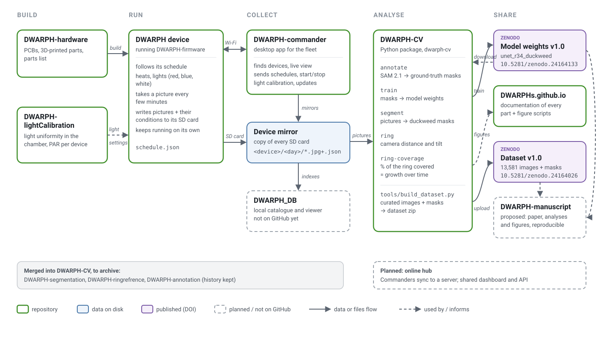
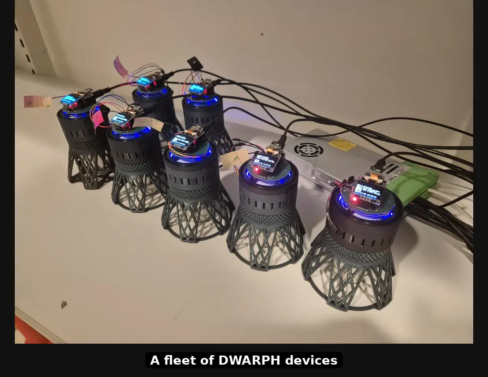

# Modules and repositories {#modules}

The DWARPH project is split into several interconnected components.
The [DWARPHs GitHub organisation](`r GITHUB_ORG_URL`) hosts the material (source code, schedules, CAD files, analysis) for each of them.

```{r, echo=FALSE}
df <- tibble::tribble(
  ~Name, ~Status, ~Description,
  "DWARPH-firmware", "available", "ESP-IDF firmware running on the ESP32-S3 device: scheduling, temperature and light control, camera, REST API and MQTT",
  "DWARPH-commander", "available", "Python desktop application (formerly DWARPH-GUI) that discovers devices on the network, drives them and mirrors their SD cards",
  "DWARPH-CV", "available", "Python package for image analysis: duckweed segmentation (inference, training, annotation) and the ring reference for camera distance and tilt",
  "DWARPH-hardware", "available", "PCBs, 3D-printed parts and the list of off-the-shelf parts",
  "DWARPH-lightCalibration", "available", "Light measurements: light distribution and per-device PAR",
  "DWARPH-manuscript", "planned", "Manuscript material and experiments for the method publication",
  "DWARPHs.github.io", "available", "Source code of this documentation"
)
knitr::kable(df)
```

## How the parts fit together {#architecture}

<div class="figure" style="text-align: center">
<span style="display:block;" id="fig:architecture"></span>
<object data="assets/project-map.svg" type="image/svg+xml" style="width: 100%; max-width: 1400px;" aria-label="Project map">

</object>
<p class="caption">(\#fig:architecture) How the parts of DWARPH fit together, from building a device to publishing the data. Click a part to open its repository or its Zenodo record.</p>
</div>

A DWARPH deployment has two halves: any number of **devices**, and one **operator workstation** running the Commander. There is no central server and no cloud component; everything happens on the local network.

* Each **device** boots, joins the WiFi network named in its schedule, and starts executing that schedule autonomously. It keeps running whether or not anyone is watching — images and logs accumulate on its SD card.
* Each device **announces itself** over mDNS/ZeroConf, under a service name containing `dwarph`.
* Each device **publishes telemetry** to an MQTT broker once per second, and **serves a REST API** over HTTP.
* The **Commander** discovers devices by mDNS, subscribes to their MQTT topics for the live view, and uses REST for anything that needs a request/response exchange: fetching images, uploading a new schedule, starting and stopping the scheduler, streaming video, updating firmware.

The split matters in practice: MQTT carries the fast, lossy, broadcast-style state that a dashboard needs (temperature, setpoint, heater output), while REST carries the deliberate operations. A device with no broker configured still works fully over REST; MQTT is optional.

## The device firmware {#firmware}

`DWARPH-firmware` is an [ESP-IDF](https://docs.espressif.com/projects/esp-idf/en/stable/esp32/get-started/index.html) project targeting the ESP32-S3. Its main responsibilities:

* **Scheduler** (`main/scheduler`) --- parses `schedule.json`, and interpolates between setpoints to produce the temperature and light target for the current moment. This is the component that turns a static configuration file into a running experiment; it is documented in Chapter \@ref(manual).
* **Heater controller and PID** (`main/heater_controller.h`, `main/PID`) --- regulates the heating ring against the scheduled temperature. Setpoints are clamped to 10--50 °C in firmware as a safety measure.
* **Light controller** (`main/light_contoroller.hpp`, `main/led_board`) --- drives the red, blue and white channels, each on a 0.0--1.0 scale.
* **Camera** (`main/camera.h`, `main/camera_pins.h`) --- time-lapse capture at the configured interval, with a selectable focus mode. Uses a modified OV5640 autofocus driver alongside the Espressif camera component.
* **REST API** (`main/api`) --- see Section \@ref(rest-api).
* **Storage and logging** (`main/sd_card.h`, `main/logger_task`) --- images and logs are written to an SD card, under a per-device folder named after the device ID.
* **Supporting services** --- WiFi (`main/wifi_handler.h`), RTC and NTP time synchronisation (`main/RTC`, `main/time_functions.h`), an OLED status display (`main/96OLED4PINIIC.h`), and boot diagnostics.

## The Commander {#gui}

`DWARPH-commander` is a Python/Tkinter application that turns a network of devices into a single dashboard.

* `discovery.py` --- ZeroConf discovery and device record tracking
* `mqtt_service.py` --- MQTT connection, subscription and queueing
* `http_client.py` --- REST request helpers
* `dashboard_controller.py` --- orchestrates discovery and MQTT processing
* `state_store.py` --- central device/detail state store the UI binds to
* `device_card.py` --- the per-device card widget
* `device_detail_window.py` --- per-device detail, actions and API console
* `app.py` --- application shell and window composition

What it gives an operator is covered in Chapter \@ref(manual).

## Image analysis: DWARPH-CV {#ml-module}

The purpose of the imaging is quantitative: turning a time-lapse of a growth chamber into per-frame measurements of the duckweed population, and relating those to the conditions the device recorded alongside them.
`DWARPH-CV` is a Python package (`dwarph_cv`) with a single command, `dwarph-cv`, that does this on the folders the Commander mirrors from the devices:

* **Segmentation** (`dwarph-cv segment`) --- a U-Net with a ResNet34 encoder outputs a duckweed mask for every image, and the coverage (fraction of the image that is duckweed) in a table. It runs on whole 1920×1920 images, on a GPU or a CPU.
* **Ring reference** (`dwarph-cv ring`, `dwarph-cv ring-coverage`) --- finds the red reference ring in each image and solves the camera pose, giving the camera's distance and tilt for each frame. The ring also bounds the growing area: coverage is reported as the proportion of the area inside the ring that duckweed covers, which does not depend on the camera's distance.
* **Training** (`dwarph-cv train`, optional) --- leave-one-device-out training and evaluation, and training on all data for a release.
* **Annotation** (`dwarph-cv annotate`, optional) --- an interactive SAM 2.1 tool to make ground-truth masks for whole time-lapse series: click on one frame, propagate through the following frames, correct where needed.

```{r segmentation-timelapse, echo=FALSE, fig.cap="The platform, then one week of device `C4E408` with the released segmentation model: the image (left), the model's mask with the inner edge of the reference ring in red (right), and the proportion of the ring covered by duckweed over time (below), one frame per hour. Made with `scripts/make_timelapse.py`."}

```

The data and the model are published on Zenodo:

* the **DWARPH duckweed segmentation dataset** v1.0: 13,581 images from 7 devices with their ground-truth masks and metadata, [doi:10.5281/zenodo.24164026](https://doi.org/10.5281/zenodo.24164026);
* the **DWARPH segmentation weights** (`unet_r34_duckweed` v1.0), trained on all of that dataset, [doi:10.5281/zenodo.24164133](https://doi.org/10.5281/zenodo.24164133). Tested on a device it has not seen (leave-one-device-out), the same training reaches an IoU of 0.976 ± 0.007. `dwarph-cv segment` downloads the model on first use and checks its checksum; you can also give it your own weights file.

Installation is described in Section \@ref(build-cv).

## Manuscript {#manuscript-module}

*Planned --- this repository does not exist yet.*

`DWARPH-manuscript` is intended to hold the material and experiments for the method publication describing the platform, following the same pattern as the rest of the project: the analysis that produces the figures lives in the open, next to the code it describes.
