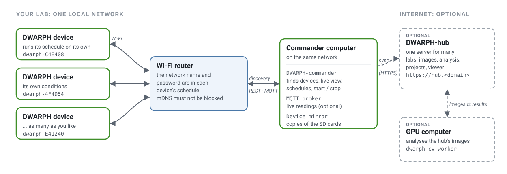

# Commander {#commander}

The **Commander** coordinates several devices on the same Wi-Fi network from one computer. It
finds the devices by itself, shows each one's latest picture, temperature and light, sends them
their schedules, starts and stops runs, and keeps a copy of every device's SD card (the *device
mirror*) on the computer.

The devices do not need it to run: once started, each follows its schedule on its own, even with
the computer switched off. The Commander is a window onto the experiment, and the way to manage
many devices at once.

<div class="figure" style="text-align: center">
<span style="display:block;" id="fig:network"></span>

<p class="caption">(\#fig:network) How the parts connect. The devices and the Commander computer are on one local network: the devices join the Wi-Fi router named in their schedule, and the Commander finds them there. Optionally, the Commander's copies of the pictures are sent to a DWARPH hub, where GPU computers analyse them (Chapter \@ref(hub)).</p>
</div>

## Requirements {#commander-requirements}

* **A computer** with Linux, Windows or macOS, and Python 3 with Tk (on some Linux distributions
  Tk is a separate package, e.g. `python3-tk`).
* **Disk space** for the device mirror: a picture is about 0.4 MB, so one device taking a picture
  every 5 minutes fills about 120 MB a day, close to 1 GB a week.
* **A Wi-Fi network** that the devices can join: 2.4 GHz (the ESP32-S3 has no 5 GHz), WPA2 with a
  password, and one on which devices may see each other (Section \@ref(network)).
* **The computer on that same network**, by Wi-Fi or by cable to the same router.
* Optionally, the **MQTT broker** for the live readings: the Commander can run it for you.

## Set up the network {#network}

The simplest and most reliable set-up is a **Wi-Fi router of your own** for the devices, with the
Commander computer connected to it. Institute and guest networks often block what DWARPH relies on:

* **mDNS** (multicast DNS, also called Bonjour or ZeroConf): each device announces itself as
  `dwarph-<ID>`, and the Commander finds devices this way. Without it, no device appears.
* **Devices seeing each other**: many networks isolate clients from one another ("client" or "AP
  isolation"). The Commander must be able to reach the devices.

To set it up:

1. On the router, create a 2.4 GHz network with WPA2 and a password, and make sure client
   isolation is off.
2. Put that network's name and password in each device's schedule (`wifiSSID` and
   `wifiPassword`; the schedule builder in Appendix \@ref(schedule-builder) has the fields). The
   device joins it when it starts. If they are wrong, the device never appears: check its display,
   or connect it by USB.
3. Connect the Commander computer to the same router.
4. Check: a device should be visible as `dwarph-<ID>.local`, e.g. `ping dwarph-C4E408.local`,
   or `avahi-browse -a` on Linux.

**Live readings (optional).** Devices publish their readings once per second over MQTT if a
broker is configured. The Commander starts a broker (Mosquitto) and announces it, and the devices
find it by mDNS; a broker elsewhere can be set in the schedule (`mqttBrokerUri`). Without a
broker, everything else works; the device cards just do not update live.

## Set up the Commander {#commander-setup}

```bash
git clone https://github.com/DWARPHs/DWARPH-commander.git
cd DWARPH-commander

python3 -m venv .venv
source .venv/bin/activate        # Windows: .\.venv\Scripts\activate
pip install -r requirements.txt

python app.py
```

On Windows, `run_app.bat` does the same in one step.

Discovery starts automatically: devices appear as cards within a few seconds. Each card shows the
device's ID, temperature and setpoint, light levels, uptime, scheduler state and latest picture.
Opening a card gives the live stream, the actions (upload a schedule, start, stop, restart,
files on the SD card, firmware update) and a debug log. Without hardware at hand, the **Mock
Device** switch shows a demonstration card.

Running an experiment --- writing a schedule, starting it, watching it and collecting the
pictures --- is described in Appendix \@ref(manual).
