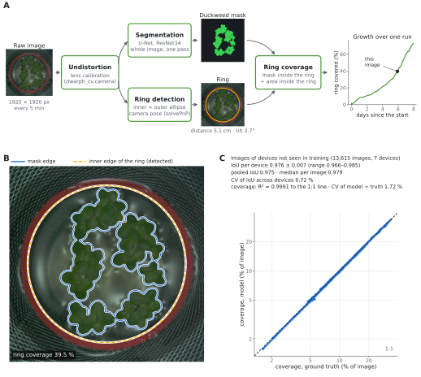

# DWARPH-CV {#cv}

[DWARPH-CV](https://github.com/DWARPHs/DWARPH-CV) turns the pictures into measurements of the
plants. It is a Python package (`dwarph_cv`) with one command, `dwarph-cv`:

* **Segmentation** (`dwarph-cv segment`) --- a U-Net with a ResNet34 encoder makes a duckweed mask
  for every picture, and a table of the area covered. It runs on whole 1920×1920 pictures, on a
  GPU or a CPU.
* **Ring reference** (`dwarph-cv ring`, `dwarph-cv ring-coverage`) --- finds the red reference ring
  and solves the camera's position, giving its distance and tilt for each picture. The ring also
  bounds the growing area: **ring coverage** is the proportion of the area inside the ring that
  duckweed covers, which does not depend on the camera's distance. It is the measure of growth.
* **Training** (`dwarph-cv train`, optional) --- leave-one-device-out training and evaluation, and
  training on all data for a release.
* **Annotation** (`dwarph-cv annotate`, optional) --- an interactive SAM 2.1 tool to make
  ground-truth masks for whole time-lapse series.
* **Worker** (`dwarph-cv worker`) --- analyses a DWARPH hub's pictures (Section \@ref(cv-worker)).

**How a picture becomes a measurement.** The segmentation and the ring detection work on the same
picture independently. The mask says where the duckweed is; the ring says where the growing area
is, and how far and how tilted the camera was. Their combination, the proportion of the area inside
the ring that the mask covers, is the coverage: one number per picture, and over a run, a growth
curve. On pictures of devices it was not trained on, the segmentation agrees closely with the
annotators' masks (Figure \@ref(fig:cv-pipeline)C).

<div class="figure" style="text-align: center">
<span style="display:block;" id="fig:cv-pipeline"></span>

<p class="caption">(\#fig:cv-pipeline) From pictures to growth. **A** The pipeline: each raw picture is segmented (U-Net, ResNet34 encoder) into a duckweed mask, and the red reference ring is detected (inner and outer ellipse, camera pose); the mask inside the ring's inner edge, divided by the area inside it, is the ring coverage, which over a run gives the growth curve (device `C4E408`, the picture shown marked). **B** The picture, undistorted, with the edges of the mask (blue) and the detected inner edge of the ring (orange). **C** Segmentation on devices the model has not seen: each of the 13,615 annotated pictures scored by the model trained without its device (leave-one-device-out), coverage predicted against annotated, with the agreement statistics. *(Draft figure for the DWARPH paper.)*</p>
</div>

## How to install {#cv-install}

You need Python 3.10 or newer and PyTorch: a CUDA build if the computer has an NVIDIA GPU (see
[pytorch.org](https://pytorch.org/get-started/locally/)); the CPU build works too, more slowly.

```bash
pip install torch torchvision --index-url https://download.pytorch.org/whl/cu126   # or .../whl/cpu

git clone https://github.com/DWARPHs/DWARPH-CV.git
cd DWARPH-CV
pip install -e .                 # segmentation, ring reference, worker
pip install -e '.[train]'        # optional: training
pip install -e '.[annotate]'     # optional: SAM 2.1 annotator (NVIDIA GPU needed)

dwarph-cv segment --input /path/to/Device_mirror/C4E408 --output preds   # masks + areas.csv
dwarph-cv ring --root /path/to/Device_mirror/C4E408                       # camera distance and tilt
```

The first run downloads the released model from Zenodo, checks its checksum and keeps it in
`~/.cache/dwarph_cv/`. `--weights path/to/model.pt` uses your own model instead. `dwarph-cv --help`
lists all the commands.

## Worker {#cv-worker}

With a DWARPH hub (Chapter \@ref(hub)), there is nothing to run by hand: **workers** analyse every
new picture as it arrives. A worker is DWARPH-CV on any computer, ideally one with a GPU:

```bash
dwarph-cv worker --hub https://hub.example.org --credentials ~/.config/dwarph/worker.json
```

It takes pictures from the hub's queue, newest first, downloads each one once, runs the ring
detection and the segmentation, and sends back the results and the mask. With nothing to do, it
waits for new pictures. Any number of workers can run at once, on as many computers. Connecting a
computer as a permanent worker, and moving all workers to a new model version, is described in
Section \@ref(hub-workers).

## Resources {#cv-resources}

The data and the model behind DWARPH-CV are published on Zenodo (Chapter \@ref(publications)):

* **[DWARPH duckweed segmentation dataset v1.0](https://doi.org/10.5281/zenodo.24164026)** ---
  13,581 pictures from 7 devices with their ground-truth masks and metadata, for training or
  testing other methods (doi:10.5281/zenodo.24164026).
* **[DWARPH segmentation weights v1.0](https://doi.org/10.5281/zenodo.24164133)**
  (`unet_r34_duckweed`) --- the released model, trained on all of that dataset. `dwarph-cv segment`
  and the workers download it on first use and check its checksum (doi:10.5281/zenodo.24164133).

The training run behind the released model (its settings, history and the leave-one-device-out
results) is in the repository, under `docs/results/`.

