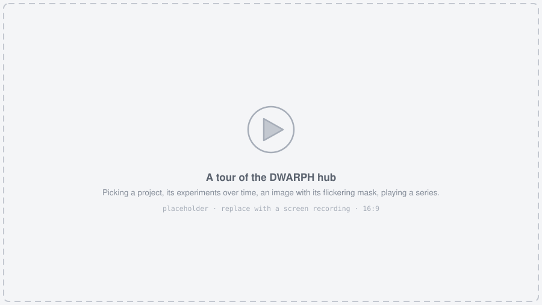

# DWARPH-hub {#hub}

**The hub is optional.** Devices, a Commander and DWARPH-CV on one computer make a complete set-up.
The hub is for **large set-ups**: many devices, from one or many Commanders, in one or several labs.
[DWARPH-hub](https://github.com/DWARPHs/DWARPH-hub) is a server that:

* **backs up** every device's pictures and their conditions, sent by the Commanders. Each
  picture is checked against the checksum its device recorded, both before it is sent and once
  it is stored;
* **analyses** them automatically: DWARPH-CV workers on GPU computers pick up every new picture
  (Section \@ref(hub-workers));
* **organises experiments** as projects, shared with the people enrolled in them;
* **shows** devices and experiments over time, in a browser: growth curves, conditions, and every
  picture with its segmentation mask one click away.

```{r hub-video, echo=FALSE, fig.cap="The hub in use. *(placeholder: a screen recording will replace it)*"}

```

## How to set up {#hub-setup}

You need:

* a **Linux server** with Docker and the compose plugin, ports 80 and 443 open: 4 GB of memory for
  real use (2 GB is enough to try it);
* a **domain** with two DNS records pointing at the server, for example `hub.example.org` (the
  hub) and `auth.example.org` (signing in);
* an **S3 bucket** (e.g. Linode or AWS object storage) and an access key **limited to that
  bucket**.

```bash
git clone https://github.com/DWARPHs/DWARPH-hub.git && cd DWARPH-hub
cp deploy/prod.env.example deploy/prod.env      # host names, bucket, key id
# one secret per file in secrets/ (database, the bucket key's secret, Authentik):
# the commands are in deploy/README.md
docker network create dwarph-edge
docker compose --env-file deploy/prod.env -f docker-compose.edge.yml up -d    # HTTPS
docker compose --env-file deploy/prod.env -f docker-compose.prod.yml up -d --build
curl https://hub.example.org/healthz
```

Then, **straight away**, open `https://auth.example.org/if/flow/initial-setup/` to set the
administrator's password, and create your own account (Section \@ref(hub-users)). Backups (a
nightly `pg_dump`; the pictures are in the bucket) and updates are described in the repository's
`deploy/README.md`.

### Connect a Commander {-}

Each lab's Commander sends its device mirror to the hub with a **machine account**:

1. In Authentik (*Directory → Users → Create service account*), create an account for the lab and
   an app password for it, and give it the **contributor** role on the hub (Section
   \@ref(hub-users)).
2. On the lab's computer, put its credentials in `~/.config/dwarph/hub.json` (readable only by you):
   `{"issuer": "https://auth.example.org/application/o/dwarph-commander/", "client_id": "dwarph-commander", "username": "...", "password": "..."}`.
3. Send the mirror:

```bash
python tools/push_mirror.py --hub https://hub.example.org --credentials ~/.config/dwarph/hub.json \
    --mirror /path/to/Device_mirror --jobs 8
```

Sending again is always safe: pictures already on the hub are skipped, and the mirror is never
changed. Run it regularly (e.g. from `cron`). *(The Commander will do this by itself once it runs
as Docker services.)*

## General structure {#hub-structure}

**Accounts.** Everyone signs in through Authentik, the hub's identity service: **people** with
a password, and **machine accounts** for the Commanders and workers, which use an app password.
Each account has one **role on the hub**:

```{r, echo=FALSE}
df <- tibble::tribble(
  ~Role, ~For, ~Can,
  "reader", "people", "see every device's pictures and analysis (under *All*), create projects",
  "contributor", "a Commander", "send devices and pictures",
  "worker", "a DWARPH-CV worker", "take pictures to analyse, send results",
  "admin", "the hub's administrators (Authentik group `dwarph-admins`)", "everything: roles, algorithms, every project"
)
knitr::kable(df)
```

**Projects.** A project describes experiments: a table with one row per experiment (a device, a
start and an end) and columns for what differs between them. A project is seen only by its
**members**, each with a role in it: **viewer** (sees it), **manager** (also edits the table) or
**owner** (also enrols people). Whoever creates a project owns it.

**Pictures and results.** The pictures are stored in the bucket exactly as on the SD cards
(`raw/<device>/<day>/<name>.jpg` with its `.json` sidecar), so the hub can always be rebuilt from
them. Results are stored per **algorithm version** (e.g. `ring-reference@1.0`,
`unet_r34_duckweed@1.0`): a new version analyses every picture again, and the older results are
kept.

**Workers** are the computers that compute the results (Section \@ref(hub-workers)).

## How to create and remove users {#hub-users}

Accounts are managed in Authentik's admin interface, `https://auth.example.org/if/admin/`
(an administrator signs in there).

**Create a person's account.**

1. *Directory → Users → Create*: username, name and e-mail.
2. Open the new user, then **Create recovery link** (or, on the server:
   `docker exec dwarph-authentik ak create_recovery_key 240 <username>`, valid 4 hours), and send
   them the link. It signs them in once; they then set their own password at
   `https://auth.example.org/if/flow/default-password-change/`. No password goes through you.
3. Give them a role on the hub: **reader** for people. An administrator does this with the hub's
   API (`PUT /v1/access/<their id>` with `{"role": "reader"}`); their id is shown by
   `GET /v1/me` once they have signed in. *(A page for this in the hub is planned.)*
4. To make someone an **administrator**, add them to the group `dwarph-admins` in Authentik
   (*Directory → Groups*).

**Remove someone.** In Authentik, open the user and **deactivate** them: they can no longer sign
in, and what they had open stops working when its sign-in expires. Their name stays on what they
did (project history). Remove them from their projects too (Members, Section \@ref(hub-projects)).

**Machine accounts** (Commanders, workers): *Create service account*, then an app password for it
under *Directory → Tokens and App passwords*. Deleting the app password disconnects that computer.

## Manage projects {#hub-projects}

The hub's navigation bar has a **project selector** (*All*, each of your projects, and
**＋ New project…**) and two pages, **Project** and **Visualise**. *All* is reserved: it means every
device, no project.

**The experiment table.** One row per experiment: a **device**, a **start** and an **end**, written
`2026-09-10 12:23:00` in UTC (an empty end means still running), and your own **columns** (genotype,
treatment, replicate, ...), each with a type: text, number, whole number, yes/no, date, date-time,
or a **category** (a fixed list of values).

* Edit it in place: Tab and Enter move between cells, and a block **pasted from a spreadsheet**
  fills the table, adding rows as needed. Wrong values are marked red; amber rows use one device
  in two experiments at the same time. Each row shows how many pictures its device took in that
  time and how many are analysed.
* **Save** with a note of what changed. **History** lists every version with who changed what and
  when; any version can be looked at and **reverted to** (as a new version: nothing is lost). If
  someone saved while you were editing, your save is refused instead of overwriting theirs.
* **Members** (owners): enrol people as viewer, manager or owner, change roles, remove them.
  People are listed once they have signed in to the hub. A project always keeps an owner.
* **CSV** downloads the table with the picture counts. **Archive** hides a finished project
  (nothing is deleted).

**Visualise.** With *All*, every device over time. With a project, choose the **time axis**:
**Date** (the project's devices, only inside its experiments) or **Experiment time** (one row per
experiment, in days since it started, to compare experiments that did not start on the same day).
Show them **one row each** (the same scale in every row), **overlaid** (one line per experiment,
coloured e.g. by genotype) or as **strips**; plot the conditions (temperature, lights, ...) or
the analysis (**ring coverage**, duckweed area, camera distance and tilt). Hover a point to see the
picture; click it to open it with its details. The **mask** menu shows the segmentation over it,
steadily or **flickering**; ← → step through the series and Space plays it. The hub remembers your
settings for each project.

## Link workers {#hub-workers}

Any computer with DWARPH-CV (Section \@ref(cv-install)) can analyse the hub's pictures; one with an
NVIDIA GPU does it in a fraction of a second per picture.

1. Create a **machine account** for it (Section \@ref(hub-users)) with the **worker** role, and put
   its credentials in `~/.config/dwarph/worker.json`.
2. Once per DWARPH-CV version, an administrator **registers** the algorithms it computes, which
   queues every picture for them:
   `dwarph-cv worker --hub https://hub.example.org --credentials admin.json --register-only`.
3. **Run** the worker (`dwarph-cv worker --hub ... --credentials ~/.config/dwarph/worker.json`), or
   install it as a **service** that keeps running and updates itself: see `tools/worker/` in
   DWARPH-CV.

Workers can be anywhere with an internet connection, and any number can run at once. A picture
being analysed is reserved for a few minutes only, so a worker that is switched off simply leaves
its pictures to the others.

**A new version.** When a new model or ring-detection version is released, an administrator
registers it with `--register-only --retire-older`. Every running worker notices within minutes,
restarts on the new DWARPH-CV, and every picture is analysed again; the older results are kept.
