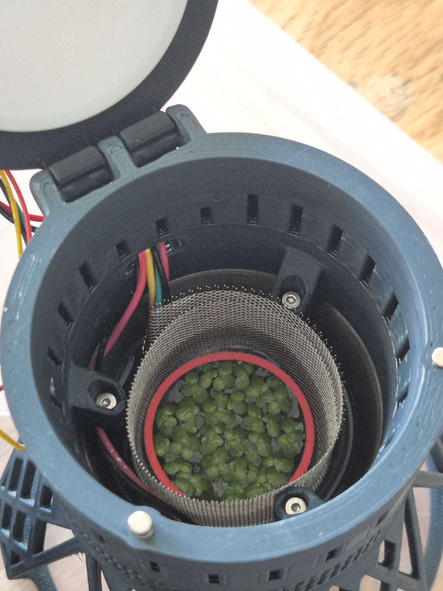

[screwdriver]:Parts.yaml#screwdriver
[red reference ring]:Parts.yaml#ring
# Assemble the device

{{BOM}}

## Put it together {pagestep}

Mount the boards and the camera in the printed enclosure with a [screwdriver]{Qty: 1, Cat: tool}.
Route the cables clear of the heater and of the camera's view, so nothing is pinched by the lid.

## Place the reference ring {pagestep}

Place the [red reference ring]{Qty: 1} in the vessel, centred under the camera. It bounds the
growing area and lets DWARPH-CV measure the camera's distance and tilt.

> **TODO:** the assembly sequence, screws, and photos of each stage.
