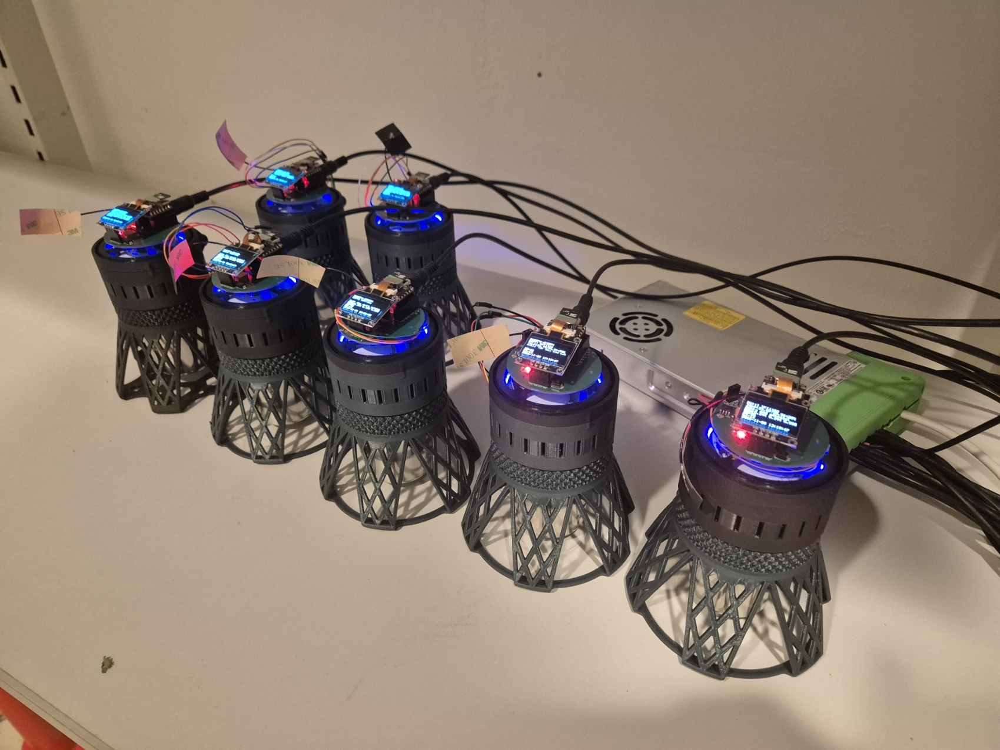

# Build a DWARPH device

This guide takes you from parts to a working DWARPH device: a small growth chamber that
controls temperature and light, follows a schedule, and photographs the plants. At the end the
device is checked step by step over USB with DWARPH-QC, and only then runs experiments.

For what DWARPH is and how to use it, see the [main documentation](https://dwarphs.github.io/).
The design files are in the [DWARPH-hardware](https://github.com/DWARPHs/DWARPH-hardware)
repository and the firmware in [DWARPH-firmware](https://github.com/DWARPHs/DWARPH-firmware).

> **Work in progress.** Steps marked **TODO** need details, photos or files that are not
> documented yet. Please add them as you build.

Everything you need for one device is in the [bill of materials]{BOM}.

The steps, in order:

1. [.](printed_parts.md){step}
1. [.](boards.md){step}
1. [.](rtc_cell.md){step}
1. [.](camera.md){step}
1. [.](wiring.md){step}
1. [.](assembly.md){step}
1. [.](firmware.md){step}
1. [.](qc.md){step}
