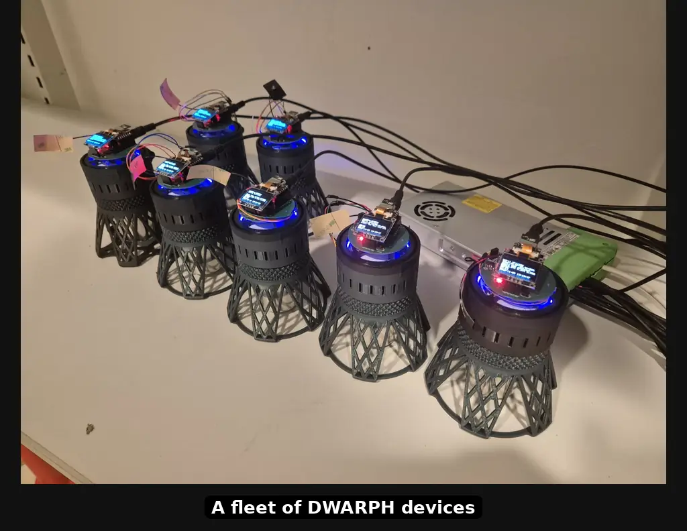
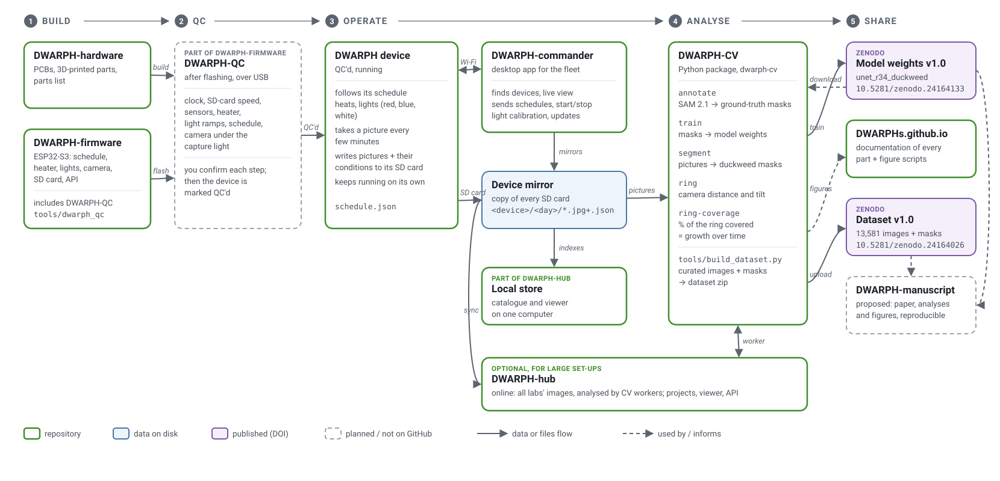

```{r, echo=FALSE}
source('./global_variables.R')
```

# What is DWARPH? {#intro}

```{r landing-video, echo=FALSE, out.width="100%", fig.alt="DWARPH devices, then one week of duckweed growth in device C4E408 with the segmentation mask and the proportion of the ring covered over time"}

```

*This is the reference documentation for the DWARPH platform.
It describes what the system does, the parts it is made of, how to build and install them, and how to run an experiment.*

**DWARPH** (Duckweed Automatic Robot for PHenotyping) is a small growth chamber that grows duckweed under the conditions you choose and photographs it automatically, so you can measure how it grows.

With DWARPH you can:

* **Set the conditions.** Choose the temperature and the colour and brightness of the light (red, blue and white), and let them change over the day --- warm days and cool nights, for example --- repeated for as many days as the experiment lasts.
* **Record the plants without being there.** Each device takes a picture at the interval you choose, day and night, and notes the temperature and light with every picture.
* **Run many chambers at once.** The devices are cheap enough to build several, so one experiment can be repeated in many chambers side by side.
* **Watch and control them from one computer.** The DWARPH Commander app finds your devices by itself and shows each one's latest picture, temperature and light. From it you can send a device a new program, start or stop a run, and copy all the pictures to your computer.
* **Measure growth.** DWARPH-CV turns the pictures into numbers: for every picture, how much of the growing area is covered by duckweed, as in the video above.

Once started, a device follows its program on its own, even when your computer is switched off.

DWARPH is open source. The hardware designs, the device software, the desktop app, the analysis tools and the hub are all in the [DWARPHs GitHub organisation](`r GITHUB_ORG_URL`).

## How the parts fit together {#overview}

<div class="figure" style="text-align: center">
<span style="display:block;" id="fig:architecture"></span>
<object data="assets/project-map.svg" type="image/svg+xml" style="width: 100%; max-width: 1400px;" aria-label="Project map">

</object>
<p class="caption">(\#fig:architecture) How the parts of DWARPH fit together, in the order you use them: build a device, check it with QC (part of the firmware), operate it, analyse the pictures, share the results. Click a part to open its repository or its Zenodo record.</p>
</div>

```{r, echo=FALSE}
df <- tibble::tribble(
  ~Part, ~Chapter, ~"What it is",
  "[DWARPH-hardware](https://github.com/DWARPHs/DWARPH-hardware)", "\\@ref(device)", "Circuit boards, 3D-printed parts and the list of off-the-shelf parts; the [device build guide](build/)",
  "[DWARPH-firmware](https://github.com/DWARPHs/DWARPH-firmware)", "\\@ref(device)", "The program on the device's ESP32-S3: schedule, temperature and lights, camera, SD card, Wi-Fi; includes the QC check of a new device",
  "[DWARPH-commander](https://github.com/DWARPHs/DWARPH-commander)", "\\@ref(commander)", "Desktop app that finds the devices on the network, drives them and copies their SD cards",
  "[DWARPH-CV](https://github.com/DWARPHs/DWARPH-CV)", "\\@ref(cv)", "Image analysis: duckweed segmentation and ring coverage, camera distance and tilt; training and annotation; the hub's workers",
  "[DWARPH-hub](https://github.com/DWARPHs/DWARPH-hub)", "\\@ref(hub)", "*Optional, for large set-ups:* a server that backs up, analyses and shows every device's pictures, organised in projects",
  "[DWARPHs.github.io](https://github.com/DWARPHs/DWARPHs.github.io)", "", "This documentation"
)
knitr::kable(df)
```

Each chapter covers one part: the **device** (hardware, firmware and QC), the **Commander**, **DWARPH-CV** and the optional **hub**, then **utilities** such as the schedule builder, the **publications** and how to get help. The appendices describe running an experiment and the technical reference.

> **This documentation is a work in progress.** The platform is under active development; sections marked *planned* describe intent, not shipped code.
